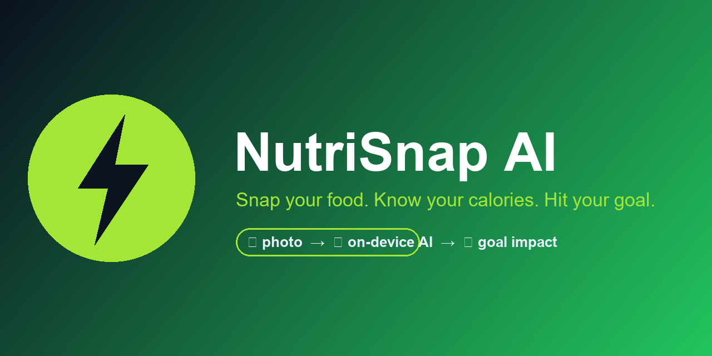
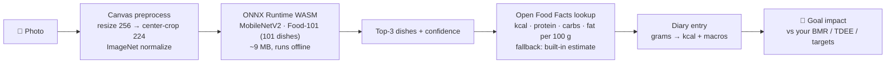

<div align="center">
  
</div>

<h1 align="center">📸 NutriSnap AI</h1>
<p align="center"><b>Snap a photo of your food — on-device AI recognizes the dish, tells you the calories &amp; macros, and shows how it fits your goal</b> (lose fat ⚖️ / maintain / gain muscle 💪 / gain weight 📈).</p>

<p align="center">
  <a href="https://github.com/YOUR-USERNAME/nutrisnap-ai"></a>
  
  
  
  
  
</p>

<p align="center">
  👉 <b>Live demo:</b> <a href="https://YOUR-USERNAME.github.io/nutrisnap-ai/">https://YOUR-USERNAME.github.io/nutrisnap-ai/</a>
</p>

---

## ✨ Features

| Feature | What it does |
|---|---|
| 📸 **Photo scan (AI)** | Take/upload a food photo → a neural network runs **100% in your browser** (ONNX Runtime WASM, no server, no API key) and shows the top-3 dishes with confidence → calories & macros are looked up automatically |
| 🔍 **Food search** | Live search over **3M+ products** via the open [Open Food Facts](https://world.openfoodfacts.org) API, plus barcode lookup |
| ⚡ **Quick add** | One-tap common foods (chicken breast, rice, eggs, whey…) with per-100 g values |
| ➕ **Custom food** | Type any meal with its own calories/macros |
| 🎯 **Personal plan** | Onboarding (age, sex, height, weight, activity, goal) → **BMR (Mifflin-St Jeor) → TDEE → daily calorie target + protein/carbs/fat** for your goal |
| 📊 **Dashboard** | Calorie ring, macro bars, **per-food "goal impact" chips** (e.g. "🥩 35% of protein goal — ✔ within goal"), water tracker, day navigation |
| 📈 **Stats** | 7-day calorie chart with target line, weight trend, weekly average |
| 📱 **Installable PWA** | "Add to Home Screen" on phone/desktop; works **offline** (service worker caches the app + the 9 MB model after first load) |
| 🔒 **Private by design** | No accounts, no backend, no database — all data stays in your browser's `localStorage`; photos are processed on-device and **never uploaded** (see [SECURITY.md](SECURITY.md)) |

## 🧠 How the AI photo scan works



- **Model:** MobileNetV2 fine-tuned on [Food-101](https://data.vision.ee.ethz.ch/cvl/datasets_extra/food-101/) (76% top-1 accuracy), exported to ONNX opset 17 (`tools/export_alexkoff88.py`), served locally from `assets/`.
- **Runtime:** `onnxruntime-web` 1.17.3 WASM (vendored, single-threaded — works on any host, no special headers needed).
- Verified end-to-end in-browser: pizza photo → `pizza 91%`, sushi → `sushi 88%`, salad → `caesar salad 90%`…

## 🚀 Run it locally

No build step — plain HTML/CSS/JS. Any static server works:

```bash
# option 1: Python
python -m http.server 8080

# option 2: Node (bundled, with a strict file allowlist)
node server.js
```

Then open <http://127.0.0.1:8080>.

## 📱 Install the app (PWA)

- **Android (Chrome/Edge):** open the link → ⋮ menu → **"Add to Home screen"** → it installs like a native app (icon, fullscreen, offline).
- **iPhone (Safari):** open the link → Share ⎋ → **"Add to Home Screen"**.
- **Desktop (Chrome/Edge):** open the link → click the **install icon** in the address bar.

First photo scan downloads the ~9 MB model once (with progress bar); afterwards it's cached and works offline.

## 🗂 Project structure

```
index.html  styles.css  app.js  data.js  labels.js   # the app (vanilla, no build)
manifest.webmanifest  sw.js                          # PWA + offline caching
server.js                                            # dev/tunnel static server (allowlist-only)
assets/food101_mnv2_ak.onnx                          # on-device food classifier (9 MB, Apache-2.0)
assets/banner.png  icons/                            # branding + PWA icons
vendor/onnxruntime-web/                              # ONNX Runtime WASM (MIT), vendored
tools/                                               # dev scripts used to build/test the model
ASSIGNMENT_ANSWERS.md                                # course form answers (EN + AR)
SECURITY.md                                          # privacy/security notes
LICENSE                                              # MIT (code); see file for 3rd-party licenses
```

## 🔒 Privacy & security

No API keys, no accounts, no tracking, no uploads. User data lives only in the visitor's
`localStorage`; food photos are classified on-device. The server (`server.js`) serves an
**allowlist** of app files only. Full details: [SECURITY.md](SECURITY.md).

## 🧪 How it was built & tested (vibe-coding)

Built with an AI coding agent (OpenCode) in one session: model research on Hugging Face →
ONNX export & accuracy tests in Python (`tools/test_generic.py`) → app code → in-browser
end-to-end tests (onboarding math, search, photo classification, diary, charts) → deployed
via a temporary Cloudflare quick tunnel and (permanently) GitHub Pages.

## 📝 Course assignment

See [ASSIGNMENT_ANSWERS.md](ASSIGNMENT_ANSWERS.md) for the form answers: problem, idea, and link (English + Arabic).

## 📜 License

Code: [MIT](LICENSE). Third-party: onnxruntime-web (MIT), Food-101 model (Apache-2.0),
Open Food Facts data (ODbL).
